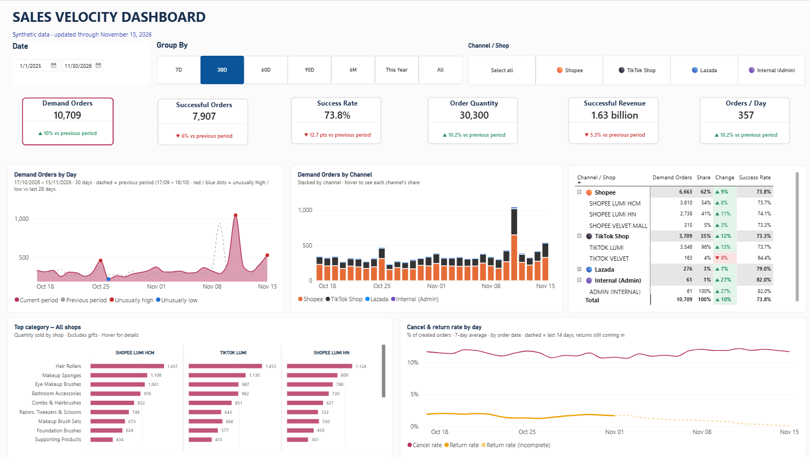
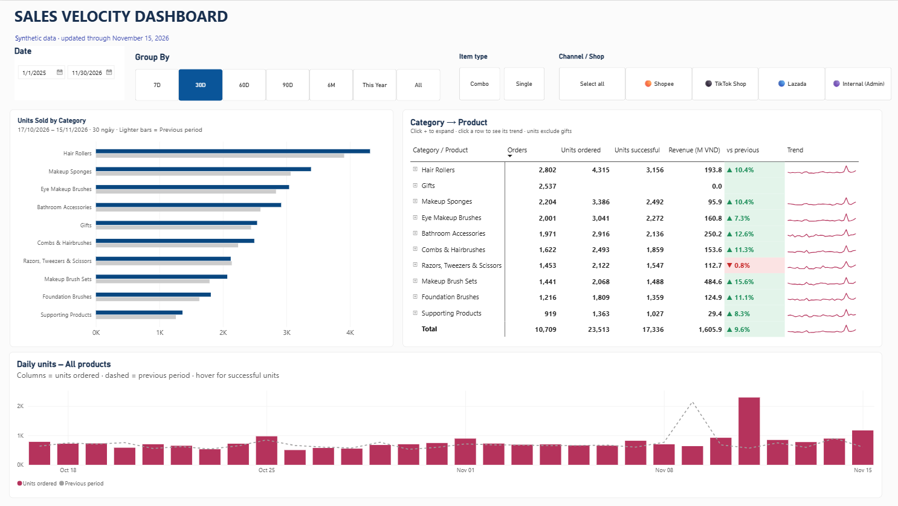
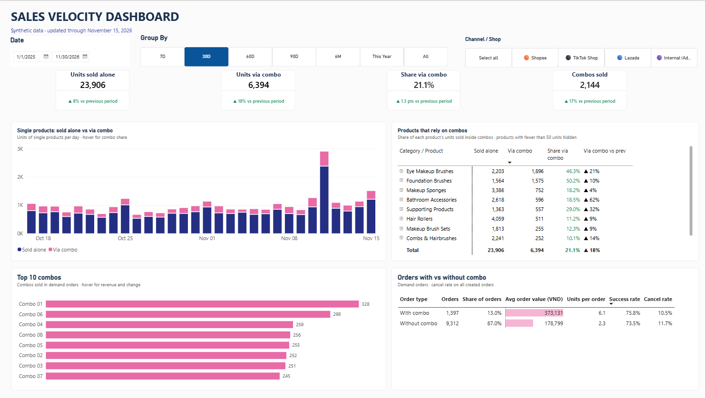
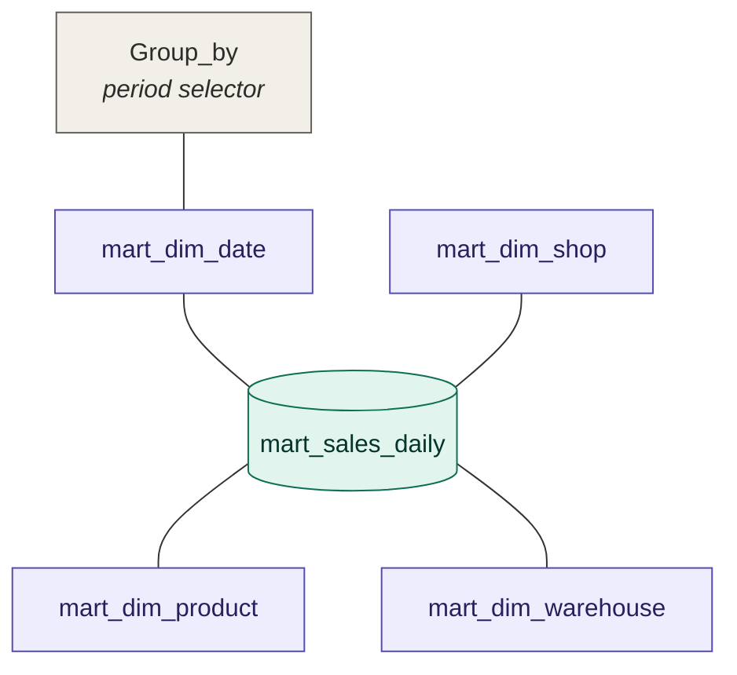

# Sales Velocity Dashboard — Multi-channel E-commerce (Power BI)

A Power BI dashboard that tracks **how fast orders are coming in, from which channel, and how many of them actually turn into revenue** for a multi-channel e-commerce retailer selling on Shopee, TikTok Shop, Lazada and an internal (B2B/admin) channel.

> **Data notice:** This project is based on a dashboard I built at work. All company names, shop names and figures in this repository have been replaced with **synthetic data** that keeps the same structure as the original. No real business data is shared.



---

## 1. Business problem

The business sells the same product catalog across several marketplaces and shops. Before this dashboard, the team had to export orders from each channel and combine them in Excel to answer simple daily questions:

- Are we selling **faster or slower** than the previous period?
- Which **channel / shop** is driving growth, and which is falling behind?
- How many created orders are **actually delivered** (not cancelled or returned)?
- Which **categories and products** sell best, and in which shop?
- How much do **combos (bundles)** contribute, and which products depend on them?
- Was today's volume **unusual**, or just normal day-to-day noise?

**Audience:** Sales, Marketing, Operations and Management teams.

## 2. Report pages

All pages share the same controls: a date range, quick period buttons (**7D, 30D, 60D, 90D, 6M, This Year, All**) and a channel / shop selector. Every number is compared with the **previous period of the same length**.

### Page 1 – Overview

| Visual | What it shows |
|---|---|
| **KPI cards** | Demand Orders · Successful Orders · Success Rate · Order Quantity · Successful Revenue · Orders/Day, each with ▲ / ▼ vs previous period. Clicking a card switches the metric used in the daily chart |
| **Daily trend** | Selected metric by day vs previous period (dashed), with **anomaly markers**: red = unusually high, blue = unusually low |
| **Demand Orders by Channel** | Stacked daily columns showing each channel's contribution |
| **Channel / Shop matrix** | Orders, share, growth and success rate, drill-down from channel to shop |
| **Top category by shop** | Units sold per category, side by side for the leading shops (gifts excluded) |
| **Cancel & return rate** | 7-day rolling average; the last 14 days of return rate are dashed because returns are still coming in |

### Page 2 – Channel & Product



| Visual | What it shows |
|---|---|
| **Units Sold by Category** | Current vs previous period per category |
| **Category → Product matrix** | Orders, units ordered vs successful, revenue, change vs previous period and a daily **sparkline**; expand a category to see its products |
| **Daily units** | Units ordered per day vs previous period; follows the category / product selected in the matrix |
| **Item type filter** | Switch between single products and combos |

### Page 3 – Combo



| Visual | What it shows |
|---|---|
| **KPI cards** | Units sold alone · units sold via combo · share via combo · combos sold |
| **Sold alone vs via combo** | Daily units of single products, split by how they were sold |
| **Products that rely on combos** | Share of each product's units sold inside combos, with change vs previous period |
| **Top 10 combos** | Best-selling combos, with revenue and change in the tooltip |
| **Orders with vs without combo** | Order count, share, average order value, units per order, success and cancel rate |

## 3. Key metric definitions

| Metric | Definition |
|---|---|
| Demand Orders | Orders created in the period (test orders excluded) |
| Successful Orders | Demand orders that were delivered successfully (not cancelled or returned) |
| Success Rate | Successful Orders ÷ Demand Orders |
| Order Quantity | Total units in demand orders, with combos counted as their component units |
| Successful Revenue | Amount collected from successful orders |
| Orders / Day | Average Demand Orders per day in the selected period |
| vs previous period | Same metric for the period of equal length immediately before the selected one |
| Unusually high / low | A day more than 40% above (high) or 20% below (low) the **median** of the previous 28 days |
| Units via combo | Units of a single product sold inside combos (combos exploded into component SKUs) |

## 4. Data model

The Power BI model sits on top of a **mart layer** and uses a **fact constellation** design: five fact tables at different grains share the same conformed dimensions, so one slicer (date, shop, product, warehouse) filters every visual consistently.

**Core star: the main sales fact** (the other four fact tables follow the same star pattern; see the bus matrix below)



**Full model: which dimension filters which fact (bus matrix)**

| Fact table | `mart_dim_date` | `mart_dim_shop` | `mart_dim_product` | `mart_dim_warehouse` |
|---|:---:|:---:|:---:|:---:|
| `mart_sales_daily` | ✓ | ✓ | ✓ | ✓ |
| `mart_sku_demand_daily` | ✓ | ✓ | ✓ | ✓ |
| `mart_inventory_daily` | ✓ |  | ✓ | ✓ |
| `mart_orders` | ✓ | ✓ |  | ✓ |
| `mart_order_lines` | ✓ (created date) | ✓ | ✓ | ✓ |

All dimension → fact relationships are one-to-many, single direction. `Group_by` → `mart_dim_date` is many-to-one with both-direction filtering. Order-level facts are always filtered through the shared dimensions, so `mart_orders` → `mart_order_lines` is kept as an **inactive** relationship to avoid ambiguous filter paths.

**Fact tables**

| Table | Grain | Used for |
|---|---|---|
| `mart_sales_daily` | date × shop × product × warehouse | Demand vs. successful quantity and revenue, cancelled/returned quantity, discounts, platform fees, net received amount |
| `mart_sku_demand_daily` | date × shop × SKU × warehouse | Unit demand per SKU, **including units from combos exploded into their component SKUs**, used for sales velocity and restocking |
| `mart_orders` | 1 row per order | Order status timeline (created, confirmed), carrier, COD amount, delivery city |
| `mart_order_lines` | 1 row per order line | Line-level flags: combo, free item, counts as demand, counts as revenue; created and delivered dates |
| `mart_inventory_daily` | date × product × warehouse | Available, holding and damaged stock, **days of cover**, negative-stock flag |


**Dimension and helper tables**

| Table | Purpose |
|---|---|
| `mart_dim_date` | Calendar with ISO week, month, quarter, weekend flag and `same_day_last_year_date` for year-over-year comparison |
| `mart_dim_shop` | Shop → channel (Shopee, TikTok Shop, Lazada, Internal), region, sort order, first/last order date, active flag |
| `mart_dim_product` | SKU → category and brand, combo / internal / test-product flags, first/last order date |
| `mart_dim_warehouse` | Warehouses (depots) and whether their stock is sellable |
| `Group_by` | Disconnected-style period table behind the **7D / 30D / 60D / 90D / 6M / This Year / All** buttons: each period label maps to its list of dates, and a bidirectional relationship to `mart_dim_date` lets one click filter the whole report |

**Modeling decisions**

- **Daily aggregated marts instead of raw orders** for the main visuals keep the model small and the report fast; order-level tables are kept only for drill-down.
- **Combos are exploded into component SKUs** (`qty_demand_unit_from_combo`), so the demand of each physical product is not underestimated when it is sold inside a bundle.
- **One date logic:** every fact is joined to the calendar on its main date (order created date, snapshot date), so the period buttons and the previous-period comparison behave the same on every visual.
- **Clear business flags** (`is_demand`, `is_revenue`, `is_free_item`, `is_sellable_depot`) are computed upstream, so DAX measures stay simple and every report uses the same definitions.

**Data source (original project):** orders and inventory pulled from the **Nhanh.vn API** (the order management system that consolidates all marketplace and internal orders), transformed into mart tables and refreshed **automatically**.

> **My role:** the mart layer (data warehouse) was built by the data engineering team. I designed the Power BI data model, the DAX measures and the report.

**Data source (this repo):** synthetic data generated by `scripts/generate_data.py`, with the same tables and columns as the original marts and realistic behaviour: mega-sale days, paydays, Tet, channel growth, cancellations, late-arriving returns, combos and inventory restocking (~200k orders, Jan 2025 – Nov 2026).

## 5. Key DAX measures

The full list (114 measures, grouped by display folder) is in [`dax/measures.md`](dax/measures.md). A few core patterns:

```DAX
Demand Orders =
CALCULATE ( DISTINCTCOUNT ( mart_orders[order_id] ), mart_orders[is_demand] = TRUE () )

Successful Orders =
CALCULATE (
    DISTINCTCOUNT ( mart_orders[order_id] ),
    mart_orders[is_demand] = TRUE (),
    mart_orders[is_revenue] = TRUE ()
)

Success Rate = DIVIDE ( [Successful Orders], [Demand Orders] )

-- Previous period of the same length as the selection.
-- Works for the KPI cards and, day by day, for the dashed line in the charts.
Đơn nhu cầu KT =
VAR s  = CALCULATE ( MIN ( mart_dim_date[date_day] ), ALLSELECTED ( mart_dim_date ) )
VAR e  = CALCULATE ( MAX ( mart_dim_date[date_day] ), ALLSELECTED ( mart_dim_date ) )
VAR n  = INT ( e - s ) + 1
VAR cs = MIN ( mart_dim_date[date_day] )
VAR ce = MAX ( mart_dim_date[date_day] )
RETURN
    CALCULATE (
        [Demand Orders],
        REMOVEFILTERS ( mart_dim_date ),
        REMOVEFILTERS ( Group_by ),
        mart_dim_date[date_day] >= cs - n,
        mart_dim_date[date_day] <= ce - n
    )

-- Baseline for anomaly markers: median of the previous 28 days
_Baseline chọn =
VAR d       = MAX ( mart_dim_date[date_day] )
VAR batDau  = MAX ( d - 28, DATE ( YEAR ( d ), 1, 1 ) )
VAR ketThuc = d - 1
RETURN
    CALCULATE (
        MEDIANX ( VALUES ( mart_dim_date[date_day] ), [Current period] ),
        REMOVEFILTERS ( mart_dim_date ),
        REMOVEFILTERS ( Group_by ),
        mart_dim_date[date_day] >= batDau,
        mart_dim_date[date_day] <= ketThuc
    )

Unusually high =
VAR v = [Current period]
VAR b = [_Baseline chọn]
RETURN
    IF (
        ISINSCOPE ( mart_dim_date[date_day] ) && NOT ISBLANK ( b ),
        IF ( v > b * 1.4, v )
    )
```

**Techniques used:** field-parameter style metric switching (clicking a KPI card changes the chart), dynamic titles and subtitles, conditional formatting driven by measures (▲ / ▼ colours, card borders), `ALLSELECTED`-based share and ranking, sparklines in matrices, and measures organised into display folders.

## 6. Insights (on synthetic data)

- **Shopee is the backbone, TikTok Shop is the growth engine.** Shopee still brings over 60% of orders, but TikTok Shop's share grew from ~20% (Jan 2025) to ~34% (Oct 2026). Orders for Jan–Oct 2026 are up ~18% year over year.
- **Mega-sale days drive the peaks.** Double-date campaigns (1.1 … 12.12) average ~2.7× the orders of a normal day, and the anomaly markers flag them immediately. Stock and ad budget need to be planned around these dates.
- **Tet changes the rhythm.** Orders rise in the 2–3 weeks before Lunar New Year, then drop sharply during the holiday, so restocking has to be finished early.
- **Growth is not the same as quality.** TikTok Shop has the highest cancel rate (~12.7% vs ~10.5% on Shopee), so its success rate is lower (~84% vs ~87%). Ad spend decisions should look at successful orders, not just demand orders.

## 7. Business impact (original project)

- **Saved ~90% of daily reporting time** by replacing manual Excel downloads and processing with one automatically refreshed dashboard.
- **Purchasing & inventory:** sales velocity by category and shop showed which products were selling faster than expected, helping the team decide what and how much to restock before stock-outs, especially ahead of mega-sale days and holidays.
- **Product bundling:** comparing category performance across shops highlighted fast movers and slow movers, which supported decisions on which products to bundle into combos to push slower items.
- **Advertising budget:** growth and success rate by channel helped decide whether to increase ad spend and on which channel, prioritising channels where orders were growing and most orders were successfully delivered.
- **Operations:** the cancel and return trend made delivery and fulfilment problems visible early instead of at month-end.

## 8. Tools

Power BI (DAX, Power Query, data modeling) · Nhanh.vn API (original data source) · Python (Pandas, NumPy) for synthetic data generation

## 9. Repository structure

```
sales-velocity-dashboard/
├── README.md
├── sales_velocity_portfolio.pbix        # Power BI file (synthetic data)
├── scripts/generate_data.py   # synthetic data generator (one CSV per model table)
├── dax/measures.md            # all DAX measures of the report
├── docs/powerquery_csv.md     # Power Query code to load the CSV files
├── images/                    # dashboard screenshots
└── data/                      # created by the script, not committed (files are large)
    ├── mart_dim_date.csv, mart_dim_shop.csv, mart_dim_product.csv, mart_dim_warehouse.csv
    └── mart_sales_daily.csv, mart_sku_demand_daily.csv, mart_inventory_daily.csv,
        mart_orders.csv, mart_order_lines.csv
```

## 10. How to use

- **Just explore the report:** open `sales_velocity_portfolio.pbix` in Power BI Desktop. The synthetic data is already loaded.
- **Rebuild the data from scratch:**
  ```bash
  pip install pandas numpy
  python scripts/generate_data.py      # writes the CSVs to ./data
  ```
  Then in Power BI open **Transform data → Manage parameters**, set `DataFolder` to the full path of the `data\` folder (with a trailing backslash), and click **Refresh**.

---

**Author:** Nguyen Dang Yen Vy · [GitHub](https://github.com/ndyvy) · [LinkedIn](https://www.linkedin.com/in/yenvy1805)
